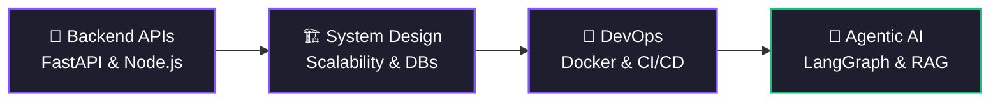

<div align="center">

# 👋 Hey there, I'm **Anurag Hom Roy**

### 🚀 Full-Stack Engineer | 🤖 AI & LLM Systems | ⚙️ Backend & DevOps

<p align="center">
  
</p>

<p align="center">
  <a href="https://anurags-portfolio.onrender.com">
    
  </a>
  <a href="https://www.linkedin.com/in/anurag-hom-roy/">
    
  </a>
  <a href="mailto:homroyanurag@gmail.com">
    
  </a>
  
</p>

---

**I architect and ship full-stack applications, autonomous AI/LLM pipelines, and scalable backend systems.**  
Focused on high-concurrency backend engineering, distributed system design, Retrieval-Augmented Generation (RAG), and containerized infrastructure.

</div>

---

## ⚡ Engineering Focus & Current Work

```yaml
name: Anurag Hom Roy
role: Full-Stack & AI Engineer
current_focus:
  - Architecting multi-agent LLM workflows and enterprise RAG systems (LangChain, LangGraph)
  - Designing scalable RESTful APIs and microservices using FastAPI, Node.js, and PostgreSQL
  - Containerizing applications and streamlining deployments with Docker and Linux
  - Sharpening algorithmic problem-solving and data structures in C++
philosophy: "I break things in development so they never break in production."
```

---

## 🛠️ Tech Stack & Ecosystem

<div align="center">

| Category | Technologies |
| :--- | :--- |
| **💻 Languages** |      |
| **🧠 AI & ML** |      |
| **⚙️ Backend & DB** |       |
| **🎨 Frontend** |      |
| **🐳 DevOps & Tools** |       |

</div>

---

## 🚀 Featured Engineering Projects

<table align="center">
  <tr>
    <td width="50%" valign="top">
      <h3>🏥 VitalAI</h3>
      <p><b>AI-Powered Healthcare Triage & Telemedicine Platform</b></p>
      <p>Bridges the gap between patients, frontline health workers, and doctors using intelligent symptom assessment and real-time clinical workflows.</p>
      <p><b>Stack:</b> <code>Next.js</code> <code>FastAPI</code> <code>Python</code> <code>MongoDB</code> <code>LLMs</code></p>
      <p>
        <a href="https://github.com/Anurag370"></a>
      </p>
    </td>
    <td width="50%" valign="top">
      <h3>🧠 Enterprise-RAG</h3>
      <p><b>Autonomous Organizational Knowledge Engine</b></p>
      <p>Production-grade Retrieval-Augmented Generation pipeline for querying dense internal documentation with high factual accuracy and context retention.</p>
      <p><b>Stack:</b> <code>Python</code> <code>FastAPI</code> <code>LangChain</code> <code>LangGraph</code> <code>Vector DB</code></p>
      <p>
        <a href="https://github.com/Anurag370"></a>
      </p>
    </td>
  </tr>
  <tr>
    <td width="50%" valign="top">
      <h3>👤 FaceRecog</h3>
      <p><b>Automated Biometric Attendance System</b></p>
      <p>Real-time computer vision pipeline that detects, embeds, and verifies student faces from live video streams to automate attendance logging.</p>
      <p><b>Stack:</b> <code>Python</code> <code>FastAPI</code> <code>OpenCV</code> <code>InsightFace</code></p>
      <p>
        <a href="https://github.com/Anurag370"></a>
      </p>
    </td>
    <td width="50%" valign="top">
      <h3>📝 Notes App & 🌐 Developer Portfolio</h3>
      <p><b>Full-Stack Web Applications</b></p>
      <p>RESTful MERN stack note-taking application with persistent CRUD storage, alongside my responsive personal developer portfolio.</p>
      <p><b>Stack:</b> <code>React</code> <code>Node.js</code> <code>Express</code> <code>MongoDB</code> <code>TailwindCSS</code></p>
      <p>
        <a href="https://anurags-portfolio.onrender.com"></a>
        <a href="https://github.com/Anurag370"></a>
      </p>
    </td>
  </tr>
</table>

---

## 🗺️ System Architecture & Learning Roadmap



---

## 📊 GitHub Telemetry

<div align="center">
  
  
</div>

<div align="center">
  
</div>

---

<div align="center">

### 🤝 Open for Collaborations, Internships & Full-Stack / AI Roles
*If you find my repositories useful, consider dropping a ⭐!*

</div>
